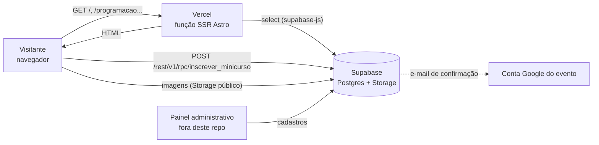

# Aula 09 — Documentação de Software

Atividade da Aula 09 (Documentação de Software), aplicada ao projeto
[**setec-publico**](https://github.com/mkrosz/setec-publico): o site público da
**SETEC — Semana de Tecnologia da FATEC Sorocaba**.

A primeira parte reúne a documentação do projeto: objetivo, problema, escopo,
requisitos, tecnologias, arquitetura e componentes. A segunda parte é o
**README.md** proposto para o repositório, com pré-requisitos, instalação,
configuração, execução, API, banco de dados, testes e deploy.

---

## Parte 1 — Documentação do projeto

### 1.1 Objetivo

Divulgar a SETEC num único site público. Nele o visitante vê a programação
(palestras e minicursos), os palestrantes, os apoiadores e a comissão
organizadora, e se inscreve nos minicursos que têm vagas limitadas. Todo o
conteúdo vem de um banco **Supabase (Postgres)** mantido pela comissão num
painel administrativo separado, então o site não precisa ser alterado nem
publicado de novo a cada mudança na programação.

### 1.2 Problema

Antes do site, as informações do evento ficavam espalhadas em posts de
Instagram, PDFs e formulários avulsos. Isso gerava alguns problemas:

- a programação mudava (horário, sala, palestrante) e as versões antigas
  continuavam circulando;
- as inscrições nos minicursos eram controladas à mão, e o mesmo aluno podia
  se inscrever duas vezes ou passar do limite de vagas;
- não havia um lugar oficial para listar apoiadores e membros da comissão;
- os dados pessoais dos inscritos (nome, RA, e-mail) não tinham uma
  finalidade e uma política de uso declaradas, como pede a LGPD.

### 1.3 Escopo

**Dentro do escopo (este repositório):**

| Página / recurso | Descrição |
| --- | --- |
| `/` (Home) | Hero com edição e datas, faixa de apoiadores, as 3 próximas atividades, chamada para inscrição (Sympla / minicursos) e redes sociais. |
| `/programacao` | Palestras e minicursos agrupados por dia e ordenados por horário, com filtros por **tipo**, **categoria** e **período** (manhã, tarde, noite, madrugada). |
| Modal de palestra | Detalhes da palestra, um ou mais palestrantes (foto, cargo, bio) e links (LinkedIn, GitHub, site...). |
| Modal de minicurso | Detalhes, barra de vagas e **formulário de inscrição** (nome, RA, e-mail, turma). |
| `/comissao` | Membros da comissão organizadora agrupados (professores, 4º/5º ano, cursos da manhã e da noite por semestre). |
| `/privacidade` | Política de privacidade das inscrições, com a base legal da LGPD. |
| `/minicursos` | Redirecionamento 301 para `/programacao?tipo=minicurso` (link antigo). |
| `404` | Página de erro personalizada. |
| Tema claro/escuro | Alternado na barra de navegação inferior e salvo no `localStorage`. |
| Modo "evento inativo" | Com `evento_ativo = false` no banco, o site mostra só o Hero e a chamada, e `/programacao` redireciona para `/`. |

**Fora do escopo:**

- O **painel administrativo** (cadastro de palestras, minicursos, apoiadores,
  comissão, lista de inscritos e presença): é outro sistema.
- O **envio do e-mail de confirmação** da inscrição: acontece no backend
  (Supabase + conta Google do evento), fora deste repositório.
- A venda ou emissão de ingressos, feita pelo **Sympla** (o site só leva até lá).

### 1.4 Requisitos funcionais

| ID | Requisito |
| --- | --- |
| RF01 | Exibir na Home o nome da edição, as datas e a instituição, lidos da tabela de configuração do evento. |
| RF02 | Exibir as próximas 3 atividades: palestras que ainda não terminaram e minicursos que ainda não começaram, no fuso de São Paulo. |
| RF03 | Listar a programação completa agrupada por dia e ordenada por horário de início. |
| RF04 | Filtrar a programação por tipo (palestra/minicurso), categoria e período do dia; aceitar `?tipo=minicurso` na URL. |
| RF05 | Abrir um modal com os detalhes da palestra, seus palestrantes e links externos. |
| RF06 | Mostrar as vagas restantes de cada minicurso e marcar como "esgotado" ou "encerrado" quando for o caso. |
| RF07 | Inscrever o aluno no minicurso com nome, RA, e-mail e turma, chamando a função `inscrever_minicurso` do banco. |
| RF08 | Validar o formulário: RA só com números (5 a 20 dígitos), e-mail válido, turma obrigatória e sugestão de correção para domínios digitados errado (ex.: `gmial.com` → `gmail.com`). |
| RF09 | Listar os apoiadores ordenados por cota (Master, Diamond, Titanium, Platinum, Gold). |
| RF10 | Listar os membros da comissão organizadora por grupo e semestre. |
| RF11 | Exibir a política de privacidade das inscrições. |
| RF12 | Esconder a programação quando o evento estiver marcado como inativo. |
| RF13 | Alternar entre tema claro e escuro e lembrar a escolha do visitante. |

### 1.5 Requisitos não funcionais

| ID | Categoria | Requisito |
| --- | --- | --- |
| RNF01 | Atualização | Mudanças feitas no painel aparecem no site sem novo deploy: as páginas são renderizadas no servidor (SSR) a cada acesso, sem cache HTTP. |
| RNF02 | Desempenho | Uma única consulta traz as palestras já com os palestrantes; os dados do evento ficam em cache por 5 segundos na mesma requisição; o navegador não carrega a biblioteca do Supabase (a inscrição usa `fetch` direto na API REST). |
| RNF03 | Segurança | O front-end usa só a chave pública (*anon key*); as regras de acesso ficam no banco (RLS e funções). Links vindos do banco só são aceitos com `http(s)://` e o texto é inserido com `textContent`, para evitar injeção de HTML. |
| RNF04 | Privacidade (LGPD) | Coleta só os dados necessários (nome, RA, e-mail, turma), com finalidade declarada; o site público mostra apenas a quantidade de inscritos, nunca os dados de quem se inscreveu. |
| RNF05 | Integridade | A função do banco controla limite de vagas e duplicidade por RA, então duas pessoas não "furam" o limite ao mesmo tempo. |
| RNF06 | Acessibilidade | Modais com foco preso (Tab/Shift+Tab), fechamento com Esc, devolução do foco a quem abriu e `aria-label` nos links. |
| RNF07 | Usabilidade | Layout responsivo (mobile first), com barra de navegação inferior flutuante e temas claro/escuro. |
| RNF08 | Manutenibilidade | TypeScript em modo `strict` e todo acesso a dados concentrado em `src/lib/data.ts`. |
| RNF09 | Disponibilidade | Hospedagem na Vercel (funções serverless) e banco gerenciado no Supabase. |

### 1.6 Tecnologias utilizadas

| Camada | Tecnologia | Versão |
| --- | --- | --- |
| Runtime | Node.js | ≥ 22.12 (exigido pelo Astro 7) |
| Gerenciador de pacotes | pnpm | 12.8.1 (fixado em `packageManager`) |
| Framework | Astro | 7.3 (`output: 'server'`) |
| Linguagem | TypeScript | 5.x (`astro/tsconfigs/strict`) |
| Estilos | Tailwind CSS (plugin Vite `@tailwindcss/vite`) | 4.3 |
| Banco / API | Supabase (Postgres + PostgREST + Storage) via `@supabase/supabase-js` | 2.x |
| Adaptador / deploy | `@astrojs/vercel` + Vercel | 11.x |
| Fontes | Google Fonts (Space Grotesk e Inter) | — |
| Integrações externas | Sympla (inscrição no evento) e Instagram | — |

### 1.7 Arquitetura

O site é uma aplicação **Astro com renderização no servidor (SSR)** rodando
como função serverless na Vercel. A cada acesso, a página busca os dados no
Supabase, monta o HTML e envia para o navegador. O único acesso feito direto
do navegador ao banco é a inscrição em minicurso.



**Fluxo de leitura (SSR):**

1. O visitante abre uma página, por exemplo `/programacao`.
2. A página Astro chama funções de `src/lib/data.ts` (`getEventInfo`,
   `getSessionsWithSpeakers`, `getMinicursos`...).
3. `data.ts` consulta o Supabase com o cliente de `supabaseClient.ts` e
   converte as colunas do banco (em português) para os tipos de
   `src/lib/types.ts`.
4. Os componentes renderizam o HTML; os dados dos modais seguem embutidos
   como JSON na página e são lidos pelo script do modal no clique.

**Fluxo de inscrição em minicurso:**

1. O aluno abre o modal do minicurso e preenche nome, RA, e-mail e turma.
2. O script valida os campos e sugere correção de e-mail se for o caso.
3. Um `POST` vai para a função `inscrever_minicurso` do Supabase, com a chave pública.
4. O banco confere vagas e duplicidade, grava a inscrição e devolve as vagas restantes.
5. O modal mostra sucesso e atualiza a barra de vagas no modal e no card.

### 1.8 Organização dos componentes

```
setec-publico/
├── astro.config.mjs        # SSR + adaptador Vercel + plugin do Tailwind
├── package.json            # scripts dev/build/preview e dependências
├── pnpm-lock.yaml          # versões travadas das dependências
├── pnpm-workspace.yaml     # libera o script de build do esbuild no pnpm
├── tsconfig.json           # TypeScript strict + alias @/* -> src/*
├── public/                 # favicon e logos estáticos
└── src/
    ├── env.d.ts            # tipagem das variáveis PUBLIC_SUPABASE_*
    ├── layouts/
    │   └── Layout.astro    # <head>, fontes, tema e barra de navegação inferior
    ├── pages/              # cada arquivo é uma rota
    │   ├── index.astro         # /
    │   ├── programacao.astro   # /programacao (filtros no cliente)
    │   ├── comissao.astro      # /comissao
    │   ├── privacidade.astro   # /privacidade
    │   ├── minicursos.astro    # redireciona para /programacao?tipo=minicurso
    │   └── 404.astro
    ├── components/
    │   ├── Hero.astro, CTASection.astro, Footer.astro, Logo.astro
    │   ├── BottomNav.astro         # navegação inferior + botão de tema
    │   ├── PartnersMarquee.astro   # faixa animada de apoiadores
    │   ├── SessionCard.astro / SessionModal.astro     # palestras
    │   ├── MinicursoCard.astro / MinicursoModal.astro # minicursos + inscrição
    │   └── SpeakerAvatars.astro    # fotos/iniciais dos palestrantes
    ├── lib/
    │   ├── supabaseClient.ts  # cria o cliente (ou null sem variáveis)
    │   ├── data.ts            # ÚNICO ponto de acesso aos dados
    │   ├── types.ts           # tipos do domínio
    │   ├── dates.ts, periods.ts, speakers.ts  # formatação e agrupamento
    │   ├── email.ts           # sugestão de correção de e-mail
    │   ├── link-chips.ts      # chips de redes sociais nos modais
    │   └── modal-a11y.ts      # foco e teclado nos modais
    └── styles/
        └── global.css         # tema Tailwind (@theme) e variáveis claro/escuro
```

| Componente | Responsabilidade |
| --- | --- |
| `lib/data.ts` | Consulta as tabelas, normaliza URLs do Storage, horários e datas ("Segunda-feira, 5 de outubro"), ordena apoiadores e sessões. Páginas e componentes nunca acessam o banco direto. |
| `lib/supabaseClient.ts` | Cria o cliente com as variáveis de ambiente. Sem elas, retorna `null` e as funções de dados devolvem listas vazias, então o site ainda abre. |
| `layouts/Layout.astro` | Estrutura comum das páginas: metadados, fontes, aplicação do tema antes da pintura (sem "piscar") e `BottomNav`. |
| `SessionModal` / `MinicursoModal` | Renderizados uma vez por página e preenchidos via JavaScript ao clicar num card (`data-session-trigger`). |
| `pages/programacao.astro` | Junta palestras e minicursos por dia e aplica os filtros no navegador, sem recarregar a página. |

---

## Parte 2 — README.md proposto para o repositório

> O conteúdo abaixo substitui o `README.md` atual do
> [setec-publico](https://github.com/mkrosz/setec-publico), que ainda descreve
> a fase de dados *mock*, o uso de `npm` e um `tailwind.config.mjs` que não
> existe mais.

---

# SETEC — Site público

Site público da **Semana de Tecnologia (SETEC) da FATEC Sorocaba**: programação
de palestras e minicursos, inscrição em minicursos, apoiadores, comissão
organizadora e política de privacidade. O conteúdo vem do **Supabase** e é
mantido pela comissão num painel administrativo separado.

## Tecnologias

- [Astro 7](https://astro.build) com SSR (`output: 'server'`)
- TypeScript (modo strict)
- Tailwind CSS 4 (via `@tailwindcss/vite`)
- Supabase (Postgres, PostgREST e Storage) com `@supabase/supabase-js`
- Vercel (`@astrojs/vercel`)

## Pré-requisitos

| Ferramenta | Versão |
| --- | --- |
| Node.js | 22.12 ou superior |
| pnpm | 12.8.1 (`corepack enable` instala a versão do `package.json`) |
| Git | qualquer versão recente |
| Projeto Supabase | com as tabelas e funções descritas em [Banco de dados](#banco-de-dados) |

## Instalação

```bash
git clone https://github.com/mkrosz/setec-publico.git
cd setec-publico
corepack enable
pnpm install
```

## Configuração

Crie um arquivo `.env` na raiz (ele já está no `.gitignore`):

```env
PUBLIC_SUPABASE_URL=https://seu-projeto.supabase.co
PUBLIC_SUPABASE_ANON_KEY=sua_chave_anon_aqui
```

| Variável | Obrigatória | Para que serve |
| --- | --- | --- |
| `PUBLIC_SUPABASE_URL` | Sim* | URL do projeto Supabase; também monta as URLs das imagens do bucket `setec-bucket`. |
| `PUBLIC_SUPABASE_ANON_KEY` | Sim* | Chave **pública** (*anon*) usada nas leituras e na inscrição. |

\* Sem as variáveis o site abre, mas sem dados (listas vazias).

> **Nunca** use a chave `service_role` aqui: variáveis com prefixo `PUBLIC_`
> vão para o navegador. A segurança dos dados depende das políticas RLS e das
> funções do banco.

## Execução

```bash
pnpm dev        # servidor de desenvolvimento em http://localhost:4321
pnpm build      # gera o build de produção (saída para a Vercel em .vercel/output)
pnpm preview    # pré-visualiza o build localmente
```

### Validando o ambiente

- A Home deve mostrar a edição e as datas do evento. Se aparecer só "SETEC"
  e nenhum apoiador ou atividade, confira as variáveis do `.env` e reinicie o
  `pnpm dev`.
- `/programacao` voltando para `/` significa que `evento_ativo` está `false`
  na tabela de configuração.
- Imagens quebradas costumam indicar arquivo ausente no bucket `setec-bucket`
  ou bucket sem leitura pública.

## Rotas

| Rota | Descrição |
| --- | --- |
| `/` | Home: hero, apoiadores, próximas atividades e chamadas |
| `/programacao` | Palestras e minicursos por dia, com filtros (aceita `?tipo=minicurso`) |
| `/comissao` | Comissão organizadora |
| `/privacidade` | Política de privacidade (LGPD) |
| `/minicursos` | Redireciona (301) para `/programacao?tipo=minicurso` |

## Banco de dados

O site **só lê** estas tabelas/views do Supabase (todas em `src/lib/data.ts`):

| Tabela / função | Uso | Campos principais |
| --- | --- | --- |
| `event_config` (ou `configuracoes`) | Dados da edição | `edicao`, `datas`, `ano`, `evento_ativo`, `logo_url`, `sympla_url`, `instagram_url` |
| `palestras` | Palestras publicadas (`rascunho = false`) | `titulo`, `categoria`, `data`, `hora_inicio`, `hora_fim`, `local`, `sobre_palestra`, `palestrantes` (jsonb), `links` (jsonb) |
| `minicursos` | Minicursos publicados (`rascunho = false`) | `titulo`, `categoria`, `data`, `hora_inicio`, `hora_fim`, `local`, `sobre`, `vagas`, `ministrantes` (jsonb), `links` (jsonb) |
| `patrocinadores` | Apoiadores | `nome_empresa`, `logo_url`, `nivel` (master, diamond, titanium, platinum, gold) |
| `comissao_publica` | Comissão organizadora | `nome`, `email`, `grupo` (professor, 4ano, 5ano, manha, noite), `semestre` |
| `presenca_turmas` | Turmas do formulário de inscrição | `nome` |
| `minicursos_vagas()` (RPC) | Inscritos por minicurso | retorna `minicurso_id`, `inscritos` |
| `inscrever_minicurso()` (RPC) | Grava a inscrição | ver [API](#api) |

Formato esperado dos campos jsonb:

```json
// palestrantes / ministrantes
[{ "nome": "Ana Souza", "cargo": "Engenheira de Dados", "foto_url": "palestrantes/ana.jpg", "sobre": "..." }]

// links (type: linkedin | site | instagram | github | facebook | twitter | youtube)
[{ "type": "linkedin", "label": "", "url": "https://www.linkedin.com/in/ana" }]
```

Imagens com caminho relativo são buscadas no bucket público `setec-bucket` do
Storage.

## API

O site não expõe API própria. A única escrita é a inscrição em minicurso, que
o navegador faz direto na API REST do Supabase:

```http
POST {PUBLIC_SUPABASE_URL}/rest/v1/rpc/inscrever_minicurso
apikey: {PUBLIC_SUPABASE_ANON_KEY}
Authorization: Bearer {PUBLIC_SUPABASE_ANON_KEY}
Content-Type: application/json

{
  "_minicurso": "id-do-minicurso",
  "_nome": "Nome Completo",
  "_ra": "1234567890",
  "_email": "aluno@exemplo.com",
  "_turma": "ADS 3º"
}
```

- **Sucesso (200):** retorna um número com as vagas restantes.
- **Erro:** retorna `{ "message": "..." }`, que é mostrado ao usuário (por
  exemplo, vagas esgotadas ou RA já inscrito).

## Testes

O projeto ainda **não tem testes automatizados**. Antes de abrir um Pull
Request, valide:

```bash
pnpm build      # precisa terminar com "Complete!" e sem erros de TypeScript
pnpm preview
```

Roteiro de teste manual:

1. Home exibe edição, datas, apoiadores e até 3 próximas atividades.
2. Em `/programacao`, os filtros de tipo, categoria e período combinam
   corretamente; `/programacao?tipo=minicurso` já abre filtrado.
3. O modal de palestra abre, fecha com Esc e devolve o foco ao card.
4. A inscrição em minicurso valida RA, e-mail e turma, sugere correção de
   e-mail e atualiza a barra de vagas após o sucesso (use um minicurso de
   teste no Supabase).
5. O tema claro/escuro alterna e continua o mesmo após recarregar a página.

Sugestão de evolução: testes unitários com Vitest para as funções puras de
`src/lib` (`periodOf`, `scheduleLabel`, `sugerirEmail`, `getLinkHandle`) e
testes E2E com Playwright para o fluxo de inscrição.

## Deploy

O deploy é feito na **Vercel**, integrada ao repositório do GitHub:

1. Importe o repositório na Vercel (framework detectado: Astro; a Vercel usa
   pnpm por causa do `pnpm-lock.yaml`).
2. Em *Settings → Environment Variables*, cadastre `PUBLIC_SUPABASE_URL` e
   `PUBLIC_SUPABASE_ANON_KEY` para *Production* e *Preview*.
3. Cada push na `main` gera um deploy de produção; cada Pull Request gera uma
   URL de *preview*.

Como as páginas usam SSR sem cache (`isr: false` e `Cache-Control: no-cache`
na Home), mudanças feitas no painel aparecem na hora, sem precisar de novo
deploy. Novo deploy só é necessário quando o **código** muda.

## Processo de desenvolvimento

1. Crie uma branch a partir da `main` (`feat/...`, `fix/...`).
2. Faça commits pequenos e descritivos (ex.: `fix: corrigir fuso horário na comparação de término`).
3. Rode `pnpm build` localmente.
4. Abra um Pull Request; confira o deploy de *preview* da Vercel antes do merge.
5. O merge na `main` publica em produção.

## Segurança e privacidade

- Não versione `.env` nem chaves; o `.gitignore` já ignora `.env*` (exceto `.env.example`).
- Dados de inscritos nunca aparecem no site público; apenas a contagem de vagas.
- Detalhes sobre coleta e uso de dados: página `/privacidade`.